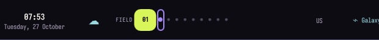
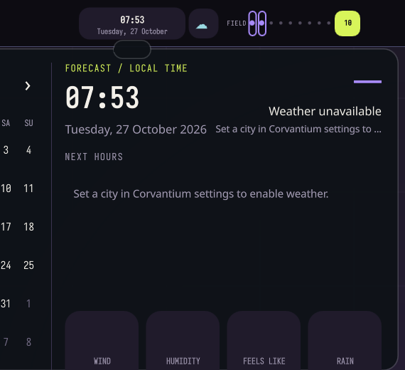

# Corvantium

**A signal-led Hyprland desktop.**

Corvantium pairs Hyprland with a compact Quickshell bar and small, connected control panels. A live workspace field, synchronized lyrics, Wi-Fi rates, Bluetooth devices, audio, weather, and time sit in a single glanceable surface. Dark mineral colors, Iosevka typography, and sharp lime signal marks give the desktop its own visual language.

The bar keeps its workspace constellation between the clock and connectivity controls. Selecting a control opens a concise panel anchored directly beneath it. The interface favors instant response and clear typography over decorative motion.

## What it includes

| Feature | Corvantium implementation |
| --- | --- |
| Backdrop | Active wallpaper shows through the transparent shell, with faint original orbital accents |
| Wallpaper picker | Super+Shift+W or the quick overlay lists images in Pictures and Wallpapers, then applies them through swww or hyprpaper |
| Separate session | Starts the installed Hyprland executable with ~/.config/corvantium/hyprland/main.lua; optional login entry named **Hyprland Corvantium** |
| Top panel | Translucent bar with a Field workspace constellation between the clock and Wi-Fi, track and lyric, keyboard layout, battery, and weather |
| Connectivity | Wi-Fi controls and live receive/transmit rates; Bluetooth power, scan, pair, connect, disconnect, forget, and battery status |
| Audio mixer | Quickshell PipeWire integration for output/input/stream listing, volume, mute, and preferred default routes |
| Calendar and weather | Local calendar navigation, local time, hourly outlook, current conditions and details; Open-Meteo, opt-in city, cache and offline state |
| Media | A compact lyrics-only popup with MPRIS track context, playback-synchronized LRCLIB lyrics, automatic current-line follow, plain-lyrics fallback, and manual timing offset |
| Hardware | Brightness hotkeys when brightnessctl has a backlight; camera toggle only when V4L2 reports a privacy control |
| Typeface | Iosevka Nerd Font across Corvantium’s bar, panels, and included Kitty profile |
| Terminal | Corvantium Kitty dimensions and colors, plus a small session-specific Zsh prompt that avoids broken system plugin paths |
| Session | Corvantium files install under ~/.config/corvantium and can be selected from the login screen |

### Screenshots

The project targets Hyprland 0.55+ and Quickshell 0.3+. Hyprland 0.55 moved new configuration to Lua; Corvantium rejects older Hyprland versions instead of supplying a mismatched config. The desktop is hardware-agnostic within the installed Wayland/Hyprland stack: it does not install or change GPU drivers or use vendor-only flags.

## Switching sessions

Corvantium uses the installed Hyprland executable with its own session profile. Log out and select **Hyprland Corvantium** in SDDM to start it; select another installed session to return. Switching sessions happens at the login screen.

## Install

The installer defaults to a dry run. It never installs packages, changes the default session, or modifies another desktop's config.

    ./scripts/install.sh
    ./scripts/install.sh --install

The install step checks Hyprland, Quickshell, and Python, prints planned destinations, asks before writing, and backs up exact files it replaces. User-edited shell/settings.json is preserved on upgrades. Managed files and launch links are restricted to Corvantium's config directory and ~/.local/bin.

Register a separately selectable **Hyprland Corvantium** entry when you choose to:

    ./scripts/install.sh --install --register-session

    The installer asks before copying Corvantium's files, then asks again before creating the **Hyprland Corvantium** entry at `/usr/share/wayland-sessions/hyprland-corvantium.desktop`. It uses sudo only for that entry, keeps a backup only if that exact path already exists, and does not replace existing session entries or change the default session.

Uninstall removes only paths recorded in Corvantium's own install manifest. Modified `shell/settings.json` is kept as user data. Restore other files that existed before installation with:

    ./scripts/install.sh --uninstall --restore

Remove the SDDM entry separately:

    ./scripts/install.sh --remove-session

To remove the session entry and restore an entry that Corvantium previously backed up, combine `--remove-session --restore`.

The installer keeps user settings and installs only the listed Corvantium-owned paths. SDDM registration remains an explicit opt-in.

## Dependencies

Required:

- Hyprland 0.55 or newer
- Quickshell 0.3 or newer, built with PipeWire and MPRIS modules
- Python 3
- PipeWire and WirePlumber for audio devices and streams

Recommended or optional:

- SDDM for the separately selectable graphical session
- NetworkManager for the network indicator; BlueZ for Bluetooth; UPower for battery reporting
- NetworkManager Wi-Fi support through Quickshell for scanning, SSID/signal display, saved networks, and protected network joins
- fuzzel, wofi, or rofi for application search
- A terminal (kitty, foot, ghostty, alacritty, wezterm, or konsole)
- Iosevka Nerd Font for Corvantium’s intended typography; other installed fonts remain usable as fallbacks
- grim and slurp for Corvantium's native region capture; hyprshot, Flameshot, or Spectacle are fallbacks
- A file manager (dolphin, thunar, nautilus, nemo, or pcmanfm)
- wpctl, playerctl, brightnessctl, v4l2-ctl, notify-send, and xdg-open for optional controls/fallbacks
- hyprshutdown for a graceful session exit (Ctrl+Alt+Delete falls back to `hyprctl dispatch exit` if it is unavailable)

Missing optional apps and devices leave a fallback/unavailable state; the installer does not run a package manager.

## Hardware compatibility and known limits

| Capability | Backend and behavior |
| --- | --- |
| GPU / display | Uses the installed Hyprland Wayland stack without vendor flags or driver changes; monitor placement and scale remain user-configurable in the Corvantium Lua profile. |
| Audio | Quickshell's PipeWire service exposes available nodes. A missing/disconnected endpoint shows an unavailable state; default routing depends on PipeWire/WirePlumber support. |
| Battery | UPower status appears when a supported device is present; desktop systems may show AC or unavailable. |
| Brightness | `brightnessctl` acts only when it sees a backlight class device; external-display DDC brightness is not implemented. |
| Camera privacy | Toggle is offered only when `v4l2-ctl` reports a writable `privacy` control. Otherwise use the device's physical shutter, hardware key, or firmware controls. |
| SDDM | Session entry registration and removal are explicit. Actual session switching depends on the installed SDDM/Wayland setup and was not exercised in this sandbox. |

Hardware-specific behavior depends on the devices and services available in the running session. The live bar and session profile are being checked in the active Corvantium desktop; SDDM switching depends on the installed display manager.

## Configure and privacy

Edit `~/.config/corvantium/shell/settings.json` after installation. Set `weather_location` to a city to enable weather, `temperature_unit` to `celsius` or `fahrenheit`, `time_format` to `24h` or `12h`, and `show_weather` to `false` to hide/disable it. Corvantium does not request GPS or upload precise device location. When weather is enabled, the city is sent to Open-Meteo's geocoding API, and the returned coordinates are used for the forecast API. Forecasts are cached locally and may be shown offline. Open-Meteo's free service is for non-commercial use; its data is published under CC BY 4.0 and the dashboard links to the provider for attribution.

The optional `applications` map accepts command names for `launcher`, `terminal`, `file_manager`, and `browser`. Empty values use the built-in installed-app detection order.

When a track changes, title, artist, album, and duration are sent to LRCLIB for a lyrics lookup. Lookups are paced and results are cached locally. A search link is offered when there is no synced match or the service cannot be reached. Lyrics are not bundled in the repository.

Camera privacy controls are not universal. Corvantium only attempts a physical toggle when a V4L2 device reports a privacy control; it does not claim that an app permission or UI state disables a camera. It does not configure passwordless sudo. Brightness changes are skipped when no backlight device is detected.

## Keybindings

| Keys | Action |
| --- | --- |
| Super tap | Application search |
| Super+Space | Search fallback |
| Super+G / Super+Tab | Corvantium quick overlay and workspace selector |
| Super+/ | Searchable keybinding guide |
| Super+1 … Super+0 | Switch workspaces 1–10 |
| Super+Shift+1 … Super+Shift+0 | Move the focused window to workspaces 1–10 |
| Super+arrows / Super+Shift+arrows | Focus / move windows |
| Super+Ctrl+Left / Right | Previous / next workspace |
| Super+E / Super+W / Super+Return | File manager / browser / terminal |
| Super+Shift+A / X | Circle to Search a selected screen region in the default browser / copy recognized screen text |
| Super+Shift+W | Choose and apply a wallpaper |
| Print Screen | Select a region and save a timestamped screenshot under Pictures/Screenshots |
| Super+Shift+S | Copy a selected screenshot region |
| Super+Shift+G | Recognize music from system audio (requires `songrec` and PulseAudio compatibility) |
| Super+V | Clipboard history (requires `cliphist`) |
| Super+J / Super+M | Hide/show top bar / toggle media panel |
| Super+Q | Close focused window |
| Super+D / Super+F / Super+Alt+Space | Maximize / fullscreen / toggle floating |
| Super+Shift+M | Toggle audio mute |
| Ctrl+Alt+Delete | End Corvantium and return to the session selector |
| Media keys | MPRIS play/pause, previous, next |
| Volume and mic keys | PipeWire/WirePlumber output and source mute/volume |
| Brightness keys | Change supported backlight brightness |
| Super+Shift+C | Toggle a detected V4L2 physical privacy control |

## Validation

    python3 -m unittest discover -s tests -v
    python3 -m py_compile shell/services/*.py
    bash -n scripts/*.sh scripts/corvantium-*
    git diff --check
    qmllint shell/shell.qml
    CORVANTIUM_CONFIG_CHECK=1 Hyprland --verify-config --config hyprland/main.lua

The static checks do not prove behavior on every audio device, player, camera, monitor, or SDDM setup. `qmllint` needs the Quickshell QML import paths. See docs/IMPLEMENTATION.md for the checks completed during development and the remaining session-level verification.

## Troubleshooting

- If the session does not appear in SDDM, use `./scripts/install.sh --install --register-session`; review both prompts and confirm that SDDM reads `/usr/share/wayland-sessions`.
- If the shell does not start, check that `qs` is version 0.3 or newer and inspect the session journal for Quickshell import/plugin errors.
- If the mixer has no devices, confirm PipeWire and WirePlumber are running in the user session. Corvantium does not parse `wpctl status` output to populate the mixer.
- If a launcher choice is unavailable, clear that key in `applications` or choose an installed executable name. Corvantium then falls back to the ordered detection list.
- For weather, set a city in `weather_location`; without it, no location lookup is sent. Network errors use the cached forecast when available.

## License

Corvantium is MIT-licensed under the repository's existing license. No third-party code or image assets have been copied into this project.
